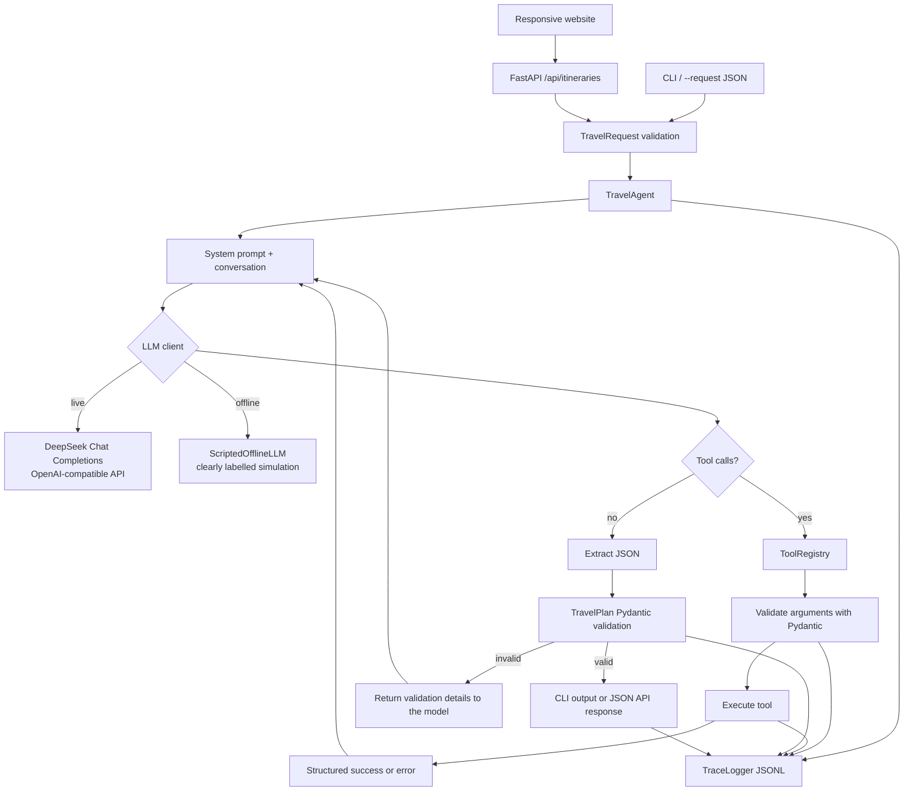

# AI Travel Planner Agent

A university programming assignment project: a genuine, explicit **tool-calling agent** that builds a validated, day-by-day travel plan with an LLM, five independent tools, an agent loop written in plain Python, Pydantic structured outputs, deterministic mock data, JSONL execution traces, and an offline test mode. It is available through both a CLI and a responsive FastAPI-served website.

> **Important:** all weather, flight, hotel, attraction, restaurant, and price data is simulated. It is not live, verified, real-time, or bookable information.

> **Windows 11 / PyCharm users:** see [RUN_GUIDE.md](RUN_GUIDE.md) for a verified, copy-paste PowerShell walkthrough covering setup, running, stopping, testing, traces, and troubleshooting.

---

## 1. Project overview

The application takes a validated travel request:

- departure city (optional, defaults to Prague)
- destination
- departure and return dates
- total budget and currency
- pace (`relaxed`, `moderate`, `intensive`)
- interests
- dietary restrictions

It then lets a DeepSeek model choose which tools to call, executes those calls through a validating registry, feeds the results back, allows the model to replan when costs exceed the budget, and accepts only a final plan that passes strict Pydantic validation.

There is no LangChain or LangGraph. The loop in `src/travel_agent/agent.py` is intentionally visible and understandable.

---

## 2. Main features

- **Real tool-calling loop**, not a fixed pipeline and not a plain chatbot.
- **Five independent deterministic tools** with typed input models, validation, structured results, and structured errors.
- **DeepSeek integration** through the official OpenAI-compatible Python SDK.
- **Multiple tool calls in one model response** and iterative replanning.
- **Configurable departure city** (Prague by default; Berlin, Vienna, and London also supported) with flight origins checked in the final schema.
- **Strict structured output** with cross-field checks: dates, itinerary days, daily totals, budget arithmetic, currency, and the selected flight/hotel/route.
- **Honest budget handling:** a plan can never be marked `budget_respected=true` when the computed total exceeds the budget.
- **Graceful recovery:** unknown tools, malformed arguments, empty results, tool exceptions, invalid final JSON, API failures, and iteration-limit exhaustion are all handled.
- **JSONL execution tracing** of the request, model messages, tool calls, results, errors, iteration numbers, and final plan.
- **Offline deterministic mode** with a clearly labelled scripted fake model, so tests and demonstrations need no API key.
- **CLI** with progress messages and a formatted final plan.
- **FastAPI web application** on `localhost:8000` with a responsive HTML/CSS/JavaScript interface, offline/live mode selection, loading states, error states, and a structured JSON API.
- **91 offline pytest tests** covering schemas, tools, registry, agent recovery, maximum iterations, trace output, and web API behavior.

---

## 3. Architecture



### Components

| Module | Responsibility |
|---|---|
| `main.py` | CLI, request collection, mode selection, error boundary |
| `config.py` | `.env` / environment configuration without exposing secrets |
| `agent.py` | Explicit bounded agent loop, message handling, validation retries, tracing |
| `llm_client.py` | LLM protocol, DeepSeek client, deterministic offline client |
| `schemas.py` | Pydantic domain models and cross-field validation |
| `mock_data.py` | Seven destinations, climate profiles, hotels, attractions, deterministic helpers |
| `display.py` | Human-readable final plan rendering |
| `tools/registry.py` | Tool definitions, OpenAI tool schemas, argument validation, execution errors |
| `tools/weather.py` | Simulated weather by city and date |
| `tools/flights.py` | Simulated round-trip flight options, sorted by price |
| `tools/accommodation.py` | Simulated hotels, nightly/total prices, sorted by total |
| `tools/attractions.py` | Simulated attractions, activities, and dietary-filtered dining |
| `tools/planner.py` | Distributes supplied attractions across days and computes daily estimates |
| `utils/trace_logger.py` | One-run-per-file JSONL trace writer |
| `utils/money.py` | Validated currencies and fixed simulated FX conversion |
| `web/app.py` | FastAPI app, routes, structured errors, static frontend |
| `web/service.py` | Runs the existing agent for web requests and closes traces |
| `web/schemas.py` | API-only request/response/error models |
| `web/static/` | Responsive HTML, CSS, and vanilla JavaScript interface |

---

## 4. How the agent loop works

`TravelAgent.run()` is deliberately a small, explicit loop:

1. Build a system prompt and a user message containing the validated request.
2. Send the conversation plus five OpenAI-compatible tool definitions to the model.
3. Log the exact request, response, model/provider metadata, and iteration number to the trace.
4. If the response contains one or more tool calls:
   - append the assistant tool-call message;
   - validate each call's arguments with the tool's Pydantic input model;
   - execute the tool through the registry;
   - capture success data or a structured error;
   - append a `role: "tool"` result message for every call;
   - continue to the next iteration.
5. If the response has no tool calls, treat it as a candidate final answer:
   - extract one JSON object;
   - validate it with `TravelPlan`, including cross-field budget and itinerary checks;
   - verify the embedded request exactly matches the original request;
   - on failure, append the validation error and ask the model to correct the JSON;
   - on success, log `final_output` and return the plan.
6. Stop with a clear error after `AGENT_MAX_ITERATIONS` (default 10).

The loop supports multiple simultaneous tool calls and repeated calls with different arguments. A tool error does not crash the process: it is returned to the model as JSON so the model can retry differently, choose cheaper options, broaden interests, or explain the limitation.

### Replanning behavior

The system prompt tells the model to:

- rerun searches without restrictive budget filters when appropriate;
- replace an unaffordable hotel or flight with a cheaper returned option;
- call the day planner again with fewer or cheaper attractions;
- set `budget_respected=false` and explain the shortfall if no feasible plan exists;
- never claim the budget is respected when the sum exceeds it.

The offline scripted client requests a second planning pass whenever the first itinerary exceeds the budget. `tests/test_agent.py` exercises this with a tighter Prague budget. The standard `traces/run_2.jsonl` run fits within budget on its first planning pass.

### Why the offline client is labelled

A scripted test double cannot make genuine LLM decisions. The offline client is therefore named `ScriptedOfflineLLM`, records `mode=offline_simulated` in every trace event, and is documented here as a reproducible test/demo aid. Live runs use the actual DeepSeek model to choose tools and compose the final JSON.

---

## 5. Tools

All tools are independent of the LLM and can be called in tests without an API key.

| Tool | Inputs | Behavior |
|---|---|---|
| `get_weather` | destination, start date, end date | One simulated weather record per day, with temperature, condition, precipitation probability |
| `search_flights` | departure city, destination, departure/return dates, optional budget, currency | Four simulated round-trip options between a supported departure airport (Prague, Berlin, Vienna, or London) and the destination, sorted by price; departure and arrival airports are explicit; `departure_city` defaults to Prague |
| `search_accommodation` | destination, check-in, check-out, optional nightly budget, currency | Simulated hotel inventory with check-in/out, nights, nightly and total price, sorted by total |
| `search_attractions` | destination, interests, optional dietary preferences, currency | Attractions, activities, and restaurants filtered by interests; dining filtered by dietary tags; clear empty-result errors |
| `create_daily_itinerary` | destination, dates, pace, attraction objects, currency | Schedules supplied non-food attractions, respects pace/closed days/opening hours/duration/30-minute transfers, and calculates daily food and transport estimates |

The day planner does **not** invent attractions or attraction prices. It excludes restaurants from paid activities to avoid double-counting food. Meal and local-transport amounts are deterministic simulated estimates.

Every tool output includes `"simulated": true` plus a note. The shared models also require the `simulated` flag to remain `true`.

---

## 6. Technology stack

- Python 3.11+ (developed and tested on Python 3.13)
- DeepSeek Chat Completions via the OpenAI-compatible API
- Official `openai` Python SDK
- Pydantic 2 for structured inputs and outputs
- `python-dotenv`
- FastAPI and Uvicorn for the local web application
- Plain HTML, CSS, and JavaScript with no frontend build step
- Standard Python `logging`
- `pytest`
- JSONL trace files
- No LangChain, LangGraph, database, frontend framework, or booking integration

---

## 7. Project structure

```text
travel-planner-agent/
├── src/travel_agent/
│   ├── __init__.py
│   ├── __main__.py
│   ├── main.py
│   ├── config.py
│   ├── agent.py
│   ├── llm_client.py
│   ├── schemas.py
│   ├── mock_data.py
│   ├── display.py
│   ├── tools/
│   │   ├── __init__.py
│   │   ├── errors.py
│   │   ├── registry.py
│   │   ├── weather.py
│   │   ├── flights.py
│   │   ├── accommodation.py
│   │   ├── attractions.py
│   │   └── planner.py
│   ├── utils/
│   │   ├── __init__.py
│   │   ├── money.py
│   │   └── trace_logger.py
│   └── web/
│       ├── __init__.py
│       ├── __main__.py
│       ├── app.py
│       ├── schemas.py
│       ├── service.py
│       └── static/
│           ├── index.html
│           ├── styles.css
│           └── app.js
├── tests/
│   ├── conftest.py
│   ├── test_config.py
│   ├── test_schemas.py
│   ├── test_tools.py
│   ├── test_registry.py
│   ├── test_llm_client.py
│   ├── test_main.py
│   ├── test_agent.py
│   └── test_web_api.py
├── examples/
│   ├── paris_vegetarian.json
│   └── prague_vegan.json
├── scripts/
│   └── generate_traces.py
├── traces/
│   ├── run_1.jsonl
│   └── run_2.jsonl
├── .env.example
├── .gitignore
├── pyproject.toml
├── requirements.txt
├── README.md
└── RUN_GUIDE.md
```

---

## 8. Installation

From the project root:

```bash
python -m venv .venv
```

Windows PowerShell:

```powershell
.\.venv\Scripts\Activate.ps1
python -m pip install --upgrade pip
python -m pip install -e ".[dev]"
```

macOS/Linux:

```bash
source .venv/bin/activate
python -m pip install --upgrade pip
python -m pip install -e ".[dev]"
```

`pip install -e ".[dev]"` makes `python -m travel_agent` and the `travel-planner` command work from the repository. `requirements.txt` contains the runtime dependencies plus pytest for convenience.

---

## 9. DeepSeek API configuration

1. Create an API key at <https://platform.deepseek.com/api_keys>.
2. Copy `.env.example` to `.env`.
3. Set:

```dotenv
DEEPSEEK_API_KEY=your-real-key
DEEPSEEK_MODEL=deepseek-flash
DEEPSEEK_BASE_URL=https://api.deepseek.com
```

The official DeepSeek documentation reviewed for this implementation specifies:

- OpenAI-compatible base URL: `https://api.deepseek.com`
- Chat Completions endpoint: `https://api.deepseek.com/chat/completions`
- Current tool-calling model names: `deepseek-flash` and `deepseek-v4-pro`
- OpenAI-style `tools` definitions, `message.tool_calls`, and `role: "tool"` result messages
- Optional thinking-mode control via `extra_body={"thinking": {"type": "disabled"}}`

References:

- <https://api-docs.deepseek.com/>
- <https://api-docs.deepseek.com/guides/tool_calls/>
- <https://api-docs.deepseek.com/quick_start/pricing>
- <https://platform.deepseek.com/api_keys>

The model name is configurable through `DEEPSEEK_MODEL`; the default is `deepseek-flash`. Model availability can change, so check the official documentation before a live run.

The API key is read only from the environment/.env. It is never printed, stored in a trace, or committed. `.env` is ignored by git.

### Live integration status

The DeepSeek request format was checked against the current official documentation and implemented with the official SDK. Live mode is available when a key is configured in `.env`; the included demonstration traces were deliberately generated in offline mode and are explicitly labelled as such. The automated test suite does not make paid API calls.

---

## 10. How to run the application

### Website (FastAPI)

From the project root, with dependencies installed:

```powershell
python -m travel_agent.web
```

Then open:

```text
http://localhost:8000
```

The website defaults to **Offline demo** mode. After the DeepSeek key is configured, switch the mode selector to **DeepSeek live**. Stop the server with `Ctrl+C`.

The FastAPI app binds to `127.0.0.1:8000`. DeepSeek traffic is outbound HTTPS to port 443; port 8000 is the local website server, not the DeepSeek connection.

The equivalent Uvicorn command is:

```powershell
python -m uvicorn travel_agent.web.app:app --host 127.0.0.1 --port 8000
```

API endpoints:

| Endpoint | Purpose |
|---|---|
| `GET /` | Responsive planning website |
| `GET /api/config` | Form options and live-mode availability |
| `GET /api/health` | Server health |
| `POST /api/itineraries` | Validate a travel request and run the existing agent |
| `GET /docs` | Generated FastAPI API documentation |

Each web run creates a trace such as `traces/web_<timestamp>_<id>.jsonl` and returns the path to the browser. The existing CLI remains available.

### Offline demonstration (no API key)

```bash
python -m travel_agent --offline
```

### Offline with an example request file

```bash
python -m travel_agent --offline --request examples/paris_vegetarian.json
```

Windows PowerShell:

```powershell
python -m travel_agent --offline --request examples/paris_vegetarian.json --trace traces/my_run.jsonl
```

### Live DeepSeek mode

After configuring `.env`:

```bash
python -m travel_agent
```

or with a request file:

```bash
python -m travel_agent --request examples/prague_vegan.json --trace traces/live_prague.jsonl
```

Live mode requires a valid key and makes a paid API call. Without a key, the program exits with a configuration message instead of silently falling back.

### CLI

The interactive CLI asks for destination, departure city (default Prague), dates, budget, currency, pace, interests, and dietary restrictions, re-prompting on invalid input. It prints progress such as:

```text
[Agent] Analyzing travel request...
[Agent] Checking simulated weather...
[Tool] get_weather completed (simulated data).
[Agent] Searching for flights...
[Tool] search_flights completed (simulated data).
[Agent] Checking accommodation...
[Agent] Comparing costs and assembling daily plans...
[Agent] Final itinerary validated.
```

It then prints the formatted plan and the trace path.

Useful options:

- `--offline` — scripted deterministic mode; no network.
- `--request FILE` — skip interactive prompts.
- `--trace FILE` — choose the JSONL trace path.
- `--max-iterations N` — override the loop bound for this run.

---

## 11. How to run tests

```bash
python -m pytest
```

The suite is fully offline and never requires `DEEPSEEK_API_KEY`. It covers:

- request/date/budget/currency validation;
- all five tools, their deterministic results, filtering, sorting, and error cases;
- tool registry schemas, unknown tools, malformed/extra arguments, tool errors, and unexpected exceptions;
- end-to-end offline agent execution with departure-city propagation;
- multiple tool calls in one model response;
- unknown tool and malformed argument recovery;
- invalid-JSON repair and final-schema validation retries;
- false budget claims and modified request objects;
- maximum-iteration termination;
- API failure handling;
- valid JSONL trace structure and final output recording;
- configuration parsing;
- JSON request loading, Prague-default behavior, and departure-city compatibility;
- FastAPI homepage/static assets, config and health endpoints;
- offline itinerary generation through the web API, structured validation errors, and live-mode availability errors.

Expected result: `91 passed` (the installed FastAPI/Starlette TestClient may emit one dependency deprecation warning).

---

## 12. Example user inputs

The original-style request:

> Plan a 3-day trip to Paris from 2027-05-10 to 2027-05-12. I will depart from Prague. My total budget is 800 EUR. I prefer a moderate pace, enjoy architecture, museums and history, and I am vegetarian.

The CLI collects this as fields. If no departure city is supplied, Prague is used. The equivalent file is `examples/paris_vegetarian.json`:

```json
{
  "destination": "Paris",
  "departure_city": "Prague",
  "start_date": "2027-05-10",
  "end_date": "2027-05-12",
  "budget": 800.0,
  "currency": "EUR",
  "pace": "moderate",
  "interests": ["architecture", "museums", "history"],
  "dietary_restrictions": ["vegetarian"]
}
```

A second example is `examples/prague_vegan.json` (Prague, departing from Berlin, 2027-09-03 to 2027-09-06, 480 EUR, relaxed, nature/food/history, vegan). A Prague destination cannot use the Prague default as its departure city, so this example specifies Berlin.

Supported simulated destinations: Paris, Prague, Rome, Berlin, Amsterdam, Vienna, Barcelona. Supported departure cities: Prague (default), Berlin, Vienna, London. The departure city must differ from the destination. Supported currencies: EUR, USD, GBP, CZK, CHF using fixed simulated rates. Trips are limited to 14 days and at least one overnight stay.

**Backward compatibility:** existing request files and direct flight-tool calls that omit `departure_city` continue to work and use Prague. The unavoidable exception is a Prague destination, because the same city cannot be both origin and destination; such a request must specify Berlin, Vienna, or London explicitly.

---

## 13. Example output

The actual offline `run_1` plan starts like this (excerpt; all values are simulated):

```text
TRAVEL PLAN - PARIS
Dates: 2027-05-10 to 2027-05-12 (3 days, 2 nights)
Pace: moderate
Interests: architecture, museums, history
Dietary preferences: vegetarian
Budget: 800.00 EUR

SIMULATED WEATHER
  2027-05-10  Cloudy with a chance of showers   11-19 C  precipitation 51%

FLIGHTS (round trip, one traveller) - SIMULATED
  Airline: Aurora Air
  Departure: Prague (PRG) | Arrival: Paris (CDG)
  Outbound 2027-05-10 06:35-08:30 | Return 2027-05-12 21:10-23:05
  Stops: 0 | Price: 120.99 EUR

ACCOMMODATION - SIMULATED
  Hôtel du Canal Saint-Martin (budget, rating 3.6/5)
  76.01 EUR per night x 2 nights = 152.02 EUR

Day 1 | 2027-05-10 | Museums & Architecture in Paris
  10:00-13:00  Louvre Museum  [22.00 EUR]
  13:30-14:30  Notre-Dame Cathedral  [0.00 EUR]
  15:00-17:00  Eiffel Tower  [29.50 EUR]
  Food estimate: 58.00 EUR | Local transport: 8.00 EUR
  Day total: 117.50 EUR

BUDGET BREAKDOWN
  Flights:                     120.99 EUR
  Accommodation:               152.02 EUR
  Food:                        174.00 EUR
  Activities:                   97.50 EUR
  Local transportation:         24.00 EUR
  Total estimated cost:        568.51 EUR
  Budget:                      800.00 EUR
  Remaining budget:            231.49 EUR
  Status:                      WITHIN BUDGET
```

The full output is in the trace's `final_output` event.

---

## 14. Mock data

`src/travel_agent/mock_data.py` contains deterministic sample data for seven cities:

- monthly climate profiles;
- four fictional hotels per city with nightly prices, categories, ratings, and locations;
- attractions, walks, activities, and restaurants with categories, descriptions, durations, simulated prices, opening days/hours, interest tags, and dietary tags;
- four simulated departure airports with deterministic price factors and timezone differences;
- route-specific flight durations, route bases, airline profiles, seasonal multipliers, meal allowances, and local-transport allowances.

The tools are deterministic: the same departure city, destination, dates, preferences, and currency produce the same results. This makes tests and traces reproducible. Names and prices are illustrative; hotel and restaurant names are fictional. The fixed FX table (`EUR`, `USD`, `GBP`, `CZK`, `CHF`) is also simulated.

Nothing in the project contacts real weather, flight, hotel, or ticketing services. There is no booking or payment functionality.

---

## 15. How to inspect execution traces

The required traces are:

- `traces/run_1.jsonl` — Paris from Prague, 2027-05-10 to 2027-05-12, 800 EUR, moderate, architecture/museums/history, vegetarian.
- `traces/run_2.jsonl` — Prague from Berlin, 2027-09-03 to 2027-09-06, 480 EUR, relaxed, nature/food/history, vegan.

Both are **actual generated runs**, not hand-written examples. They were produced by:

```bash
python scripts/generate_traces.py
```

They are clearly labelled `mode=offline_simulated` and `provider=offline_scripted`. Both traces show the requested departure city in the flight-search arguments and in the final selected flight.

Web runs create separate `traces/web_<timestamp>_<id>.jsonl` files with `mode=web_offline_simulated` or `mode=web_deepseek_live`. These generated files are ignored by Git; the two required demonstration traces remain tracked explicitly.

Each line is one JSON event with a run ID, UTC timestamp, event name, and event-specific data. Event types include:

- `run_started` — request, provider, model, limits, tool names;
- `llm_request` — full message history and tool definitions;
- `llm_response` — content, tool calls, finish reason, usage;
- `tool_call` — tool name, call ID, raw arguments, iteration;
- `tool_result` — structured tool data;
- `tool_error` — structured error and error type;
- `final_output` — accepted or rejected output and validation details;
- `run_finished` — success/error status and iteration count.

Inspect with Python:

```bash
python -X utf8 -c "import json; [print(e['event'], e.get('tool','')) for e in map(json.loads, open('traces/run_1.jsonl', encoding='utf-8'))]"
```

PowerShell:

```powershell
Get-Content traces/run_1.jsonl | Select-Object -First 3
```

To generate genuine live traces, configure a key and run:

```bash
python scripts/generate_traces.py --live
```

This overwrites `run_1.jsonl` and `run_2.jsonl` with real DeepSeek tool-calling runs and marks them `mode=deepseek_live`. A single live run can also be written elsewhere:

```bash
python -m travel_agent --request examples/paris_vegetarian.json --trace traces/live_paris.jsonl
```

Traces never include the API key or HTTP authorization headers.

---

## 16. Known limitations

- **Live mode is not exercised by the automated suite:** web tests use offline mode to avoid API charges. A live web request requires a valid key and network access.
- **Local-only web server:** FastAPI binds to `127.0.0.1:8000`; there is no authentication, TLS, or public deployment hardening.
- **Web generation is synchronous:** the UI shows a loading state, but it does not stream intermediate agent events.
- **All data is mock data:** climate, prices, availability, opening hours, hotel names, and restaurant names are simulated. They are not suitable for real travel decisions.
- **Limited departure airports:** only Prague (default), Berlin, Vienna, and London are supported. An unsupported origin is rejected with a clear validation or tool error.
- **Departure must differ from destination:** the application does not support a same-city trip from the default Prague origin to a Prague destination; specify another departure city.
- **One traveller:** costs and flight seats are per traveller. Group pricing is out of scope.
- **Fixed, simulated FX rates:** no live exchange-rate service.
- **Supported cities only:** seven European destinations; unsupported destinations produce a clear tool error.
- **14-day limit and minimum one overnight stay.**
- **Scripted offline mode is not a reasoning model:** it deliberately follows a simple deterministic decision tree and is labelled as such. Use live mode to see the LLM choose tools itself.
- **No booking, payment, or reservation functionality.**
- **No persistence/database:** the CLI, website, and JSONL traces are the interfaces.
- **Single agent:** there is no multi-agent orchestration.
- **Strict final validation can consume iterations:** if a live model repeatedly returns invalid JSON or inconsistent arithmetic, the agent stops after the configured limit with a clear error instead of pretending it succeeded.

---

## 17. How this satisfies the Homework 3 requirements

| Requirement | Implementation |
|---|---|
| AI travel planner with departure city, destination, dates, budget, currency, pace, interests, dietary needs | `TravelRequest` and CLI, JSON, and web-form inputs |
| Optional departure city with Prague default; multiple supported origins | `departure_city` field, CLI prompt, JSON support, four mock departure airports, and flight-tool validation |
| Realistic day-by-day plan with costs | Five tools + `create_daily_itinerary` + final formatter |
| DeepSeek through OpenAI-compatible SDK | `DeepSeekClient` using `OpenAI(base_url="https://api.deepseek.com")` |
| Configurable tool-calling model | `DEEPSEEK_MODEL`, default `deepseek-flash` |
| No LangChain/LangGraph | Manual loop in `agent.py` |
| At least five validated tools | Weather, flights, accommodation, attractions, planner |
| Agent decides tools/order and can iterate | LLM tool-call loop, not a fixed sequence; offline scripted mode is separately labelled |
| Multiple tool calls in one response | Loop handles every returned `tool_call`; trace `run_1` shows four in one model response |
| Invalid tool names/arguments | `ToolRegistry` returns `unknown_tool` / `invalid_arguments` to the model |
| Tool errors do not crash | Structured error messages are appended to the conversation and traced |
| Replanning | Prompt instructions plus actual second planner call in `run_2` |
| Maximum iterations / infinite-loop protection | `AGENT_MAX_ITERATIONS`, enforced counter |
| Structured Pydantic models | All required models in `schemas.py` |
| Dates, prices, currency, typed lists, required fields | Pydantic field types and validators |
| Consistent budget, no false “within budget” claim | `BudgetBreakdown` and `TravelPlan` cross-field validators |
| Mock data for several cities | Seven destinations in `mock_data.py` |
| Mock labels | `simulated: true`, notes, final disclaimer |
| JSONL traces with all required events | `TraceLogger`; two actual trace files included |
| Offline mode without API key | `ScriptedOfflineLLM`, fully offline tests |
| Clean CLI and progress output | `main.py`, `display.py` |
| FastAPI website with polished responsive frontend | `web/app.py`, `web/service.py`, and `web/static/` |
| Structured web API and error responses | `/api/itineraries`, `/api/config`, `/api/health`; Pydantic and JSON error envelopes |
| Robust validation/error handling | Request, tool, API, JSON, schema, and iteration boundaries |
| Automated tests | 91 pytest tests, all offline |
| Professional README | This document |

---

## 18. Final note

The project is intentionally modest in dependency count and architecture. The focus is on making the agent loop, tool boundaries, structured validation, error recovery, and execution trace easy to read and explain.
